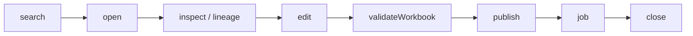

# TabKit

Headless Tableau 2026.2.4 workbook runtime and MCP server.

## Compatibility

| Contract | Version |
| --- | --- |
| Tableau target | 2026.2.4 |
| TWB | 26.2 |
| workbook XSD | 2026.2.0 |
| Tableau REST | 3.29 |
| Rust | 1.89+ |

TabKit parses, inspects, traces, edits, validates, and publishes TWB/TWBX workbooks.
It does not automate Tableau Desktop and does not implement a second Tableau XSD validator.

## Components

| Binary | Purpose |
| --- | --- |
| `tabkit-mcp` | MCP server over stdio or Streamable HTTP |
| `tabkit-extension-host` | runtime for `create_web_dashboard` |
| `tabkit` | local development/debug CLI; not a deployment artifact |

Windows x64 release artifacts:

```text
tabkit-mcp-v<version>-windows-x64.zip
tabkit-extension-host-v<version>-windows-x64.zip
```

## Supported surface

| Area | Support |
| --- | --- |
| package | TWB/TWBX open, bounded repack, preservation checks |
| inspect | datasources, connections, relations, fields, calculations, parameters, worksheets, dashboards |
| lineage | SQL/Initial SQL/Custom SQL -> field -> calculation -> worksheet -> dashboard |
| authoring | calculation, parameter, worksheet, filter action, parameter action |
| native dashboard | semantic layout, filter cards, supported worksheet styles |
| web dashboard | signed HTML/CSS/JavaScript Dashboard Extension |
| Tableau REST | search, download, `validateWorkbook`, publish, job polling |
| MCP | stdio and Streamable HTTP |

SQL Server lineage includes supported local `#temp` materialization across Initial SQL and Custom SQL.
Unsupported or ambiguous lineage is returned as an explicit gap.

## Build

```bash
cargo build --release --locked
cargo test --release --locked --all-targets
cargo fmt --all -- --check
cargo clippy --locked --all-targets -- -D warnings
```

## Tableau configuration

```text
TABLEAU_SERVER=https://tableau.example.com
TABLEAU_SITE=site-content-url
TABLEAU_PAT_NAME=pat-name
TABLEAU_PAT_SECRET=pat-secret
```

The PAT secret is read from an environment variable, not a CLI value.

## MCP

stdio:

```bash
tabkit-mcp --transport stdio
```

Streamable HTTP:

```bash
tabkit-mcp --transport http --bind 127.0.0.1:8000
```

Endpoint: `http://127.0.0.1:8000/mcp`

Set `TABKIT_MCP_TOKEN` to require a bearer token. HTTP local-path access requires explicit opt-in;
stdio allows local paths.

### Tools

```text
tableau_search_workbooks
workbook_open
workbook_inspect
workbook_lineage
workbook_edit
workbook_validate
workbook_publish
tableau_job
workbook_close
```

Typical lifecycle:



## Validation boundary

TabKit enforces package limits, supported-version admission, edit preconditions, source-preserving
patch checks, stale-base checks, and candidate reparse/postconditions.

Tableau Server remains the final authority for XSD and Tableau semantic validity through REST 3.29
`validateWorkbook` and publish.

## Current boundaries

- worksheet authoring: bar, line, KPI, text table;
- actions: filter and parameter actions;
- no raw XML mutation API;
- no Tableau Desktop automation;
- lineage identifies worksheet usage, not the exact worksheet shelf/encoding;
- arbitrary SQL provenance may produce explicit gaps;
- Tableau authentication uses PAT;
- rendering/screenshot feedback is not implemented.

## Documentation

Published documentation: https://agredyaev.github.io/tabkit/

- [Architecture](docs/ARCHITECTURE.md)
- [Workbook and package model](docs/WORKBOOK.md)
- [MCP server](docs/MCP.md)
- [Tableau REST](docs/TABLEAU_REST.md)
- [Authoring](docs/AUTHORING.md)
- [Native dashboards](docs/DASHBOARD.md)
- [Web dashboards](docs/WEB_DASHBOARD.md)
- [Extension host deployment](docs/EXTENSION_DEPLOYMENT.md)
- [Errors](docs/ERRORS.md)
- [Performance](docs/PERFORMANCE.md)
- [Rust API](docs/API.md)
- [Security](SECURITY.md)
- [Changelog](CHANGELOG.md)
