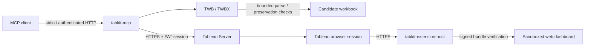

# Security policy

Security fixes target `main` and the release marked **Latest** on GitHub.

## Report a vulnerability

Use GitHub private vulnerability reporting:

https://github.com/agredyaev/tabkit/security/advisories

Include:

- affected version or commit;
- impact;
- minimal reproduction;
- diagnostic logs with secrets removed.

Do **not** include Tableau credentials, PAT values, private workbook data, signing keys, bearer tokens,
or other production secrets. Do not open a public issue for an unpatched vulnerability.

## Trust boundaries



| Boundary | Enforcement |
| --- | --- |
| MCP HTTP | exact bearer token when configured; non-loopback unauthenticated start requires explicit override |
| local workbook paths | stdio allowed; HTTP disabled unless explicitly enabled |
| Tableau REST | HTTPS only, redirects disabled, PAT secret read from environment |
| package input | size/ZIP/path/symlink/duplicate/compression-ratio limits |
| edit output | stale-base checks + byte-preservation checks |
| web-dashboard bundle | HMAC-SHA256 signature before execution |
| web-dashboard iframe | sandbox + CSP + allowlisted Tableau bridge |
| underlying Tableau data | Tableau user/workbook/datasource permissions + Full Data Access |

## MCP HTTP

Set `TABKIT_MCP_TOKEN` to require:

```text
Authorization: Bearer <token>
```

TabKit requires an exact bearer-token match when `TABKIT_MCP_TOKEN` is set. A non-loopback bind
without a token fails unless `--allow-unauthenticated-http` is set. With that flag, TabKit performs no
HTTP authentication; deployment network controls must restrict access.

## Tableau credentials

TabKit configuration stores the **name** of the PAT-secret environment variable, not the secret.
TabKit reads the secret during sign-in.

REST protections:

- HTTPS-only server URL;
- redirects disabled;
- `X-Tableau-Auth` marked sensitive;
- PAT/session values excluded from TabKit diagnostics;
- request/connect timeouts.

See [Tableau REST](docs/TABLEAU_REST.md).

## Workbook/package input

TWBX admission rejects absolute/traversal/backslash/colon/NUL/empty-segment paths, symlinks,
duplicate or case-colliding entries, expanded data above 16 GiB, entries above the
`compressed_size * 5000 + 1 MiB` ratio guard, and zero/multiple embedded TWB files.

Candidate writes re-check the source hash and verify unrelated TWBX entries remain byte-preserved.
See [Workbook and package model](docs/WORKBOOK.md).

## Web dashboards

| Control | Enforcement |
| --- | --- |
| bundle integrity | HMAC-SHA256 signature verified before execution |
| signing key | base64 32-byte `TABKIT_EXTENSION_SIGNING_KEY`; shared only by authoring and host processes |
| unsigned bundles | loopback development only |
| generated code | sandboxed iframe; no raw `tableau.extensions` object |
| Tableau access | explicit host bridge methods |
| HTML | sanitized before iframe load |
| bridge | request/response/concurrency/time limits |
| child network | blocked by CSP |
| remote host | HTTPS |
| underlying data | Tableau Full Data Access + Tableau permissions |

The sandbox and CSP are isolation layers; they do not replace signature verification.

Deployment: [Extension host deployment](docs/EXTENSION_DEPLOYMENT.md).
