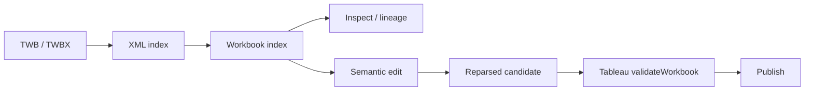

# Rust API

The crate exposes the semantic runtime used by the CLI and MCP server.

## Modules

| Module | Contract | Main entry points |
| --- | --- | --- |
| `workbook` | parse TWB into typed indexes | `Workbook::open`, `summary`, lookup/inspect methods |
| `xml` | source-backed XML spans and subtree indexes | `Document::parse`, `descendants`, `Span` |
| `package` | TWB/TWBX admission and source-preserving repack | `Package::open`, `write_candidate`, `Limits` |
| `formula` | extract Tableau field references | `analyze`, `qualified` |
| `lineage` | build/query dependency graph | `Lineage::build`, `find_kind`, `trace_limited` |
| `edit` | semantic edits -> verified candidate | `Batch`, `Edit`, `apply`, `Candidate` |
| `patch` | non-overlapping source patches | `Patch`, `apply` |
| `rest` | Tableau REST 3.29 boundary | `Config`, `Rest` |
| `mcp` | MCP state and tool handlers | `TabKitMcp` |



## Validation ownership

| TabKit | Tableau |
| --- | --- |
| package and size limits | XSD validation |
| XML parsing / supported-version admission | Tableau semantic validation |
| edit preconditions | final publish acceptance |
| patch preservation | |
| candidate reparse / postconditions | |

TabKit does not maintain a second Tableau XSD validator.

## Compatibility constants

```text
TABLEAU_PRODUCT_TARGET = 2026.2.4
TWB_VERSION            = 26.2
TWB_XSD_VERSION        = 2026.2.0
REST_API_VERSION       = 3.29
```

The four constants define one compatibility boundary.

## Rustdoc

Rustdoc documents invariants, ownership/lifetime rules, bounds, validation authority, failure
semantics, and postconditions. CI builds it with warnings denied.

[Open generated Rust API reference](../api/tabkit/index.html).
