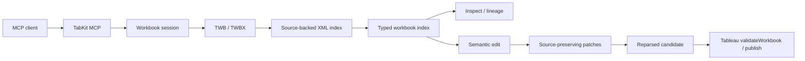
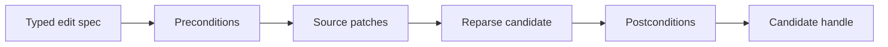

# Architecture

## Compatibility boundary

| Contract | Version |
| --- | --- |
| Tableau target | 2026.2.4 |
| TWB | 26.2 |
| workbook XSD | 2026.2.0 |
| Tableau REST | 3.29 |

TabKit keeps a typed projection of the workbook objects required by its supported operations.
It does not implement a complete Tableau object model or a second XSD validator.

## Runtime

Network work is limited to MCP transport and Tableau REST. Workbook parsing, inspection, lineage,
editing, and package mutation are local.

## Modules

| Module | Responsibility |
| --- | --- |
| `xml.rs` | XML spans, preorder subtree ranges, closing-tag offsets |
| `workbook.rs` | Tableau 26.2 typed indexes and exact-name lookup |
| `package.rs` | TWB/TWBX admission, limits, stale-base checks, repack |
| `formula.rs` | Tableau field-reference extraction |
| `lineage.rs` | dependency nodes/edges, gaps, bounded trace |
| `edit.rs` | semantic authoring and candidate postconditions |
| `patch.rs` | deterministic non-overlapping byte patches |
| `rest.rs` | Tableau REST auth/search/download/validate/publish/jobs |
| `mcp.rs` | MCP tools, workbook handles, session state |
| `extension/` | web-dashboard host runtime and Tableau bridge |
| `perf.rs` | release benchmark harness |

## Session and concurrency model

| Property | Behavior |
| --- | --- |
| workbook parse | once per opened/candidate handle |
| shared state | `Arc<Session>` |
| live handle limit | 64 |
| blocking XML/ZIP/REST work | `spawn_blocking` from MCP handlers |
| Streamable HTTP | stateless requests can reuse workbook handles |
| local paths | allowed by stdio; HTTP requires explicit opt-in |
| HTTP auth | optional bearer token; non-loopback unauthenticated startup requires explicit override |
| temporary files | owned by session and deleted when final session reference drops |

## Validation ownership

| TabKit | Tableau |
| --- | --- |
| package/size admission | XSD validation |
| supported-version checks | Tableau semantic validation |
| edit preconditions | packaged-workbook acceptance |
| patch preservation | |
| candidate reparse/postconditions | |

For TWBX, `workbook_validate` submits the embedded TWB. Package/resource acceptance is exercised by publish.

## Lineage

The main downstream contract is:

```mermaid
flowchart LR
    sql["SQL source table"]
    initial["Initial SQL"]
    temp["SQL Server #temp"]
    custom["Custom SQL"]
    physical["Physical table"]
    datasource["Datasource"]
    field["Tableau field"]
    calculation["Calculation"]
    calculated["Calculated field"]
    worksheet["Worksheet / visualization"]
    dashboard["Dashboard"]

    sql -->|SQL read| custom
    sql -->|Initial SQL read| initial
    sql -->|temp input| temp
    initial -->|temp write| temp
    temp -->|SQL read| custom

    custom -->|exact FieldOrigin when metadata resolves| field
    physical -->|exact FieldOrigin when metadata resolves| field

    custom -.->|coarse fallback| datasource
    physical -.->|coarse fallback| datasource
    datasource -.->|coarse fallback| field

    field -->|formula input| calculation
    calculation -->|output| calculated
    field -->|used by worksheet| worksheet
    calculated -->|used by worksheet| worksheet
    worksheet -->|placed on dashboard| dashboard
```

A worksheet is the visualization-level node. TabKit records that a field is used by a worksheet and
that the worksheet is placed on a dashboard. It does not currently identify the specific worksheet
encoding/shelf such as Rows, Columns, Color, Label, or Tooltip.

### SQL coverage

| Path | Behavior |
| --- | --- |
| Custom SQL | source tables are parsed and linked to the Custom SQL node |
| exact field origin | Tableau metadata `parent-name` creates `FieldOrigin` when unambiguous |
| missing exact origin | relation -> datasource -> field remains as coarse fallback |
| SQL Server Initial SQL | direct reads and supported local `#temp` materialization are modeled |
| `##global` temp table | explicit `global_temp_table_unsupported` gap |
| unsupported SQL/relation shape | explicit lineage gap; no guessed provenance |

Supported SQL Server local-temp patterns include `SELECT ... INTO #temp` and
`CREATE TABLE #temp` + `INSERT ... SELECT`, including chained local temp tables.

Exact-origin edges take precedence over coarse datasource containment during trace traversal, preventing
unrelated SQL relations in the same datasource from contaminating one another's lineage.

## Authoring model

Callers provide semantic desired state; TabKit generates Tableau IDs/XML.

Supported operations are documented in [Authoring](AUTHORING.md). Native and web dashboards have
separate presentation paths: [Native dashboards](DASHBOARD.md) and [Web dashboards](WEB_DASHBOARD.md).

## Performance invariants

| Path | Model |
| --- | --- |
| XML descendant iteration | contiguous preorder range |
| edit insertion | indexed closing-tag offset |
| exact field/lineage lookup | verified case-insensitive hash index |
| lineage trace | bounded traversal of local adjacency |
| dashboard filter resolution | one index per source worksheet per edit batch |
| candidate verification | one full reparse |
| TWBX preservation | stale-base + unrelated-entry byte checks |

Measurements: [Performance](PERFORMANCE.md).

## Non-goals

- Tableau Desktop automation;
- complete Tableau XML object model;
- local replacement for Tableau XSD/semantic validation;
- generic raw XML mutation;
- Tableau calculation execution;
- server metadata/governance replacement.
