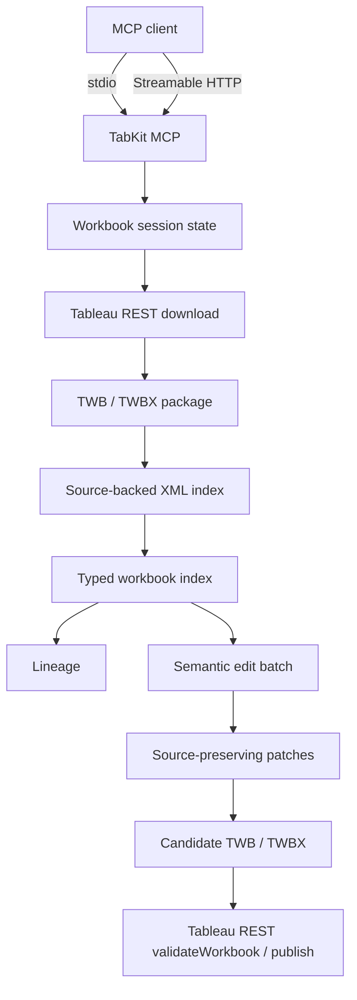
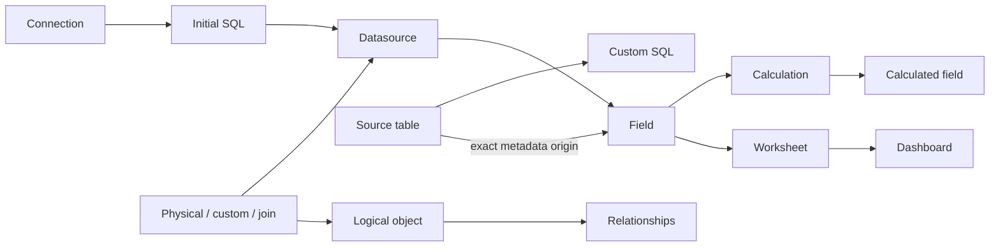

# TabKit architecture

## Runtime boundary



Network work is confined to explicit Tableau and MCP boundaries. Workbook inspection, lineage
traversal, authoring, and package mutation are local.

## Modules

- `xml.rs` — generic source-backed XML tree/index; no Tableau version semantics. Nodes are indexed in preorder with exclusive subtree ranges and closing-tag offsets, giving contiguous descendant iteration and O(1) edit insertion-point lookup.
- `text.rs` — shared case-insensitive matching/hash helpers used by semantic indexes.
- `package.rs` — TWB/TWBX admission and source-preserving repack; candidate writes return the already verified output package so MCP does not reopen it merely to create a handle.
- `workbook.rs` — Tableau 26.2 semantic projection, including parameters, typed IDs, and verified exact-label lookup indexes for the 2026.2.4 target.
- `formula.rs` — lexical extraction/validation of Tableau field references.
- `lineage.rs` — typed nodes/edges and bounded traversal.
- `patch.rs` — deterministic non-overlapping byte patches and preservation checks.
- `edit.rs` — calculation, parameter, bounded worksheet, action, native-dashboard, and web-dashboard semantic specs and lowering.
- `extension/` — Dashboard Extension host, vendored Tableau Extensions API, sandbox runtime, and explicit Tableau bridge allowlist.
- `rest.rs` — Tableau REST 3.29 auth/search/download/validate/publish/job boundary.
- `mcp.rs` — nine MCP tools over the core runtime.
- `mcp_main.rs` — stdio/Streamable HTTP launcher.
- `main.rs` — CLI.
- `perf.rs` — ignored release-only stage benchmark/profile harness.


## MCP state and concurrency

`workbook_open` parses once and stores an indexed workbook behind a generated handle. The state is
shared through `Arc`, so stateless Streamable HTTP requests can reuse handles without
`Mcp-Session-Id`.

Blocking filesystem, XML, ZIP, and Tableau REST work is executed with `spawn_blocking` from MCP
handlers so the Tokio HTTP runtime is not blocked. The process admits at most 64 live workbook
handles. A RAII session permit is atomically reserved before download/edit/parse work begins and is
released only when the final `Arc<Session>` drops, so concurrent requests cannot oversubscribe the
limit. Callers release handles with `workbook_close`. Tableau-downloaded and TabKit-generated
candidate files are likewise session-owned and removed when the final Arc drops. An in-flight
validate/publish may outlive handle removal; workspace files remain until its final session reference is released.

HTTP runs stateless and supports bearer-token authentication. Non-loopback unauthenticated startup requires
an explicit override; that override disables application-level authentication.

## Tableau schema policy

The official 2026.2.0 TWB XSD defines the external structural contract for the Tableau 2026.2.x line, including the 2026.2.4 target.
TabKit does not vendor the XSD, generate a complete Rust model from it, or maintain a second local XSD
validation engine. Only values required by the supported semantic surface are typed.

The Tableau REST 3.29 `validateWorkbook` endpoint is the validation authority: Tableau validates the
TWB against its XSD and performs semantic validation. For a TWBX, TabKit extracts and submits the
embedded TWB; package/resource correctness is ultimately exercised by the publish path.

## Lineage policy

Lineage uses dense IDs and flat edge arrays; there is no generic graph framework.



Structural/coarse edges and precise origin edges have distinct kinds. SQL source extraction uses a
conservative SQL parser: schema-qualified and quoted tables, nested/derived queries, and CTE scopes
are tracked; CTE aliases are not reported as physical sources.

For SQL Server connections, Initial SQL additionally models local `#temp` materialization. Supported
forms are `SELECT ... INTO #temp`, `CREATE TABLE #temp` followed by `INSERT ... SELECT`, chained
local temp tables, and common session/setup statements such as `SET NOCOUNT ON` and
`DROP TABLE IF EXISTS #temp`. A local temp node is keyed by Tableau connection ID, then Custom SQL
reading `#temp` resolves to that same node. Edges distinguish physical/temp inputs and the Initial
SQL write, so the graph can represent `source table -> #temp -> Custom SQL -> Tableau field`.
Unsupported T-SQL mutations preserve the modeled portion and emit
`initial_sql_lineage_partial`. SQL Server `##global` temporary tables emit
`global_temp_table_unsupported`; TabKit does not guess their cross-session/server scope.

Unsupported Initial SQL or Custom SQL otherwise produces an explicit coverage gap rather than being
guessed or silently dropped.

When metadata provides an exact `FieldOrigin`, trace traversal gives that precise edge precedence over
the coarse relation -> datasource -> field containment route. This prevents two independent SQL
relations inside the same datasource from cross-contaminating one another's upstream/downstream
lineage. Coarse containment remains as a fallback where exact origin metadata is unavailable.

Exact lineage names use a verified case-insensitive hash index. Bounded trace walks only the local
adjacency needed up to its node limit and constructs the returned induced subgraph from traversed
edges; it does not scan the complete graph after BFS.

## Authoring policy

The agent sends semantic desired-state fragments, never Tableau node IDs, XML paths,
datasource-dependency copies, or dashboard zone coordinates.

Current edit operations:

```text
create_calculation
create_parameter
create_worksheet
create_filter_action
create_parameter_action
create_web_dashboard
create_dashboard
```

Calculation batches are preflighted as one semantic unit. A calculation may reference another calculation created earlier or later in the same batch when the formula uses that target's bracketed Tableau internal `name`; captions are not rewritten into formula references. Generated calculation fields are reparsed and verified as postconditions after patch application.

Except for supported same-batch calculation references, authored dependencies are sequential. A newly created worksheet, parameter, or dashboard must be reparsed into a candidate handle before a later edit references it. Dependency resolution therefore uses one immutable typed snapshot per edit call.

Parameter authoring is limited to string/integer/real/boolean values with any/list/range domains. Worksheet authoring is limited to bar, line, KPI, and text-table structures over existing datasource fields. Unsupported combinations fail before patch application.

Filter actions use Tableau's legacy `tsc:tsl-filter` action contract to filter the other compatible worksheets on a dashboard. Parameter actions use `edit-parameter-action` and require source/target datatype compatibility. TabKit does not infer action field mappings or synthesize persisted `Apply to Worksheets` state.

Native dashboard design is expressed through nested rows/columns, fixed or weighted sizing, gaps,
container/canvas padding, text, worksheet zones, filter cards, and supported zone styles. The
compiler owns Tableau IDs, normalized geometry, dashboard datasource dependencies, and
window/viewpoint registration.

`create_web_dashboard` is a separate presentation path. It emits one full-canvas Dashboard Extension object and persists a bounded, versioned HTML/CSS/JavaScript bundle in extension instance settings. Remote bundles are HMAC-SHA256 signed by the trusted authoring process and verified by `tabkit-extension-host` before execution. Generated code runs in a sanitized sandboxed iframe and talks to Tableau only through the trusted host bridge. Direct datasource reads use Tableau Full Data Access APIs, so the extension manifest declares that permission explicitly. Compatible runtime revisions keep one stable `host.html` URL and dispatch by `runtime_version` inside the signed bundle.

Worksheet presentation may be attached to the dashboard spec as a bounded set of style patches:
font family/size/color, axis/grid/zero-line styling, mark size/line width, and label visibility.

Dashboard filter cards are presentation objects over existing worksheet Filters-shelf semantics.
TabKit scans/indexes each referenced worksheet's datasource dependencies and Filters shelf once per
edit batch, then resolves all cards from that index. It resolves the exact column-instance, verifies
the source filter, copies required dependency metadata once per unique XML node, and emits filter
zones in layout traversal order. Multiple matching column-instances are rejected unless the caller
supplies the exact instance. It does not guess or synthesize persisted cross-sheet/global `Apply to Worksheets` semantics. Cross-sheet dashboard filtering is authored separately as a filter action.

## Performance model

The runtime flow is:


The release profile harness separately measures parse/index, lineage build, exact lineage lookup,
bounded trace, exact inspect, semantic edit, 100-calculation batches, and 1/10/100-card dashboard
filter scaling. Candidate edit validation performs one full semantic reparse, but
the resulting parsed Workbook is retained instead of being copied/reparsed again for the candidate
session. See `PERFORMANCE.md`.

## Non-goals

- Tableau Desktop automation.
- Server metadata/governance/data-query replacement.
- XSD-to-Rust code generation.
- Full in-memory workbook DOM.
- Generic raw XML mutation.
- Reimplementation of Tableau calculation execution.
- Generic framework layers without a current runtime boundary.
