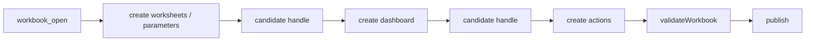

# Authoring

TabKit edits Tableau workbooks through typed semantic operations. Callers provide object names and
properties; TabKit owns Tableau XML, generated IDs, insertion points, and post-edit verification.

## Edit surface

| Operation | Creates | Depends on |
| --- | --- | --- |
| `create_calculation` | calculated field | existing datasource fields; same-batch calculations are supported |
| `create_parameter` | workbook parameter | none |
| `create_worksheet` | bar, line, KPI, or text-table worksheet | existing datasource fields |
| `create_filter_action` | dashboard filter action | existing dashboard + source worksheet |
| `create_parameter_action` | dashboard parameter action | existing dashboard + worksheet field + parameter |
| `create_dashboard` | native Tableau dashboard | existing worksheets / worksheet filters |
| `create_web_dashboard` | full-canvas HTML/CSS/JS dashboard | extension host URL |

Every `workbook_edit` returns a new candidate handle. The source handle is unchanged.

## Dependency rule

One edit call is evaluated against one immutable workbook snapshot.

Same-batch calculation references are the only cross-edit dependency resolved inside a batch.
For other dependencies, chain candidate handles:



## Parameters

| Property | Supported values |
| --- | --- |
| datatype | `string`, `integer`, `real`, `boolean` |
| domain | `any`, `list`, numeric `range` |
| list size | 1..1000 values |
| range | `min <= current <= max`, positive `step` |

```json
{
  "op": "create_parameter",
  "caption": "View Mode",
  "datatype": "string",
  "value": "Bar",
  "domain": { "kind": "list", "values": ["Bar", "Line"] }
}
```

## Worksheets

`create_worksheet` uses fields already present in one datasource.

| Kind | Required fields | Generated view |
| --- | --- | --- |
| `bar` | dimension + numeric measure | discrete dimension + aggregated measure |
| `line` | date/datetime + numeric measure | continuous month date + aggregated measure |
| `kpi` | numeric measure | text mark |
| `text_table` | 1-2 dimensions + numeric measure | dimensions + measure text |

Aggregations: `sum`, `average`, `min`, `max`, `count`, `count_distinct`.

TabKit does not implicitly create joins, relationships, fields, calculations, bins, groups, sets,
table calculations, or LOD expressions.

## Actions

| Operation | Trigger | Effect |
| --- | --- | --- |
| `create_filter_action` | `select`, `hover` | filters other compatible worksheets on the dashboard |
| `create_parameter_action` | `select`, `hover` | writes a worksheet field value to an existing parameter |

Filter actions exclude the source worksheet from their target set.

Parameter actions require a unique source `column-instance`; pass `source_instance` when the field
has multiple instances. Source and target datatypes must match. Clear-selection behavior is
`do-nothing`.

## Dashboard paths

| Need | Operation | Documentation |
| --- | --- | --- |
| Tableau-native sheets, containers, filter cards | `create_dashboard` | [Native dashboards](DASHBOARD.md) |
| arbitrary HTML/CSS/JavaScript presentation | `create_web_dashboard` | [Web dashboards](WEB_DASHBOARD.md) |

## Validation

Local edit success means:

1. operation inputs passed TabKit preconditions;
2. source-preserving patches applied;
3. candidate XML reparsed;
4. created objects were found in the reparsed candidate.

It does **not** replace Tableau validation. Run `workbook_validate` before publish; Tableau REST 3.29
`validateWorkbook` remains the XSD and semantic validation authority.
