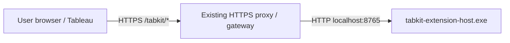

# Extension host deployment

Windows deployment for `tabkit-extension-host`.

The host can run on the same VM as the official Tableau MCP server. They are independent processes
and use different local ports.

## Target state



Final URL:

```text
https://<public-host>/tabkit/host.html
```

## Prerequisites

| Requirement | Value |
| --- | --- |
| artifact | `tabkit-extension-host-v<version>-windows-x64.zip` |
| VM | Windows x64 |
| local port | 8765 by default |
| external transport | HTTPS |
| secret | base64-encoded 32-byte `TABKIT_EXTENSION_SIGNING_KEY` |
| Tableau access | site admin or administrator able to change extension settings |

Release artifact: https://github.com/agredyaev/tabkit/releases/latest

The signing key must be identical on the TabKit authoring process and extension host.
The official Tableau MCP server does not use it.

Generate a key when required:

```powershell
$rng = [System.Security.Cryptography.RandomNumberGenerator]::Create()
$key = New-Object byte[] 32
$rng.GetBytes($key)
[Convert]::ToBase64String($key)
```

Store the value in the environment's secret-management system.

## 1. Run the host

```powershell
$env:TABKIT_EXTENSION_SIGNING_KEY="<base64-key>"
.\tabkit-extension-host.exe --bind 127.0.0.1:8765 --base-path /tabkit
```

The executable does not install itself as a Windows service. For persistent deployment, use the VM's
existing service/process supervisor.

Local check:

```powershell
(Invoke-WebRequest http://127.0.0.1:8765/tabkit/healthz).Content
```

Expected:

```text
ok
```

## 2. Publish `/tabkit/*` through HTTPS

Add one route to the existing proxy/gateway:

```text
https://<public-host>/tabkit/*
    -> http://127.0.0.1:8765/tabkit/*
```

Required routes:

| Method | Path |
| --- | --- |
| GET | `/tabkit/host.html` |
| GET | `/tabkit/host.css` |
| GET | `/tabkit/host.js` |
| GET | `/tabkit/vendor/tableau.extensions.1.17.0.min.js` |
| POST | `/tabkit/verify` |
| GET | `/tabkit/healthz` |

Preserve the `/tabkit` path. Do not place an interactive login redirect in front of these routes.

From a normal user workstation:

```powershell
(Invoke-WebRequest https://<public-host>/tabkit/healthz).Content
```

Expected: `ok`. The browser must trust the HTTPS certificate.

## 3. Allow the extension in Tableau Server

Open:

**Settings -> Extensions**

Configure:

| Setting | Value |
| --- | --- |
| extensions | enabled |
| specific extension URL | `https://<public-host>/tabkit/host.html` |
| Full Data Access | **Allow** |
| permission prompt | Show/Hide according to site policy |
| server block list | URL must not be blocked |

Use the exact `host.html` URL unless a broader trust scope is explicitly required.

## 4. Acceptance

The deployment is ready when all checks pass:

- [ ] host process is running;
- [ ] localhost `/healthz` returns `ok`;
- [ ] public HTTPS `/healthz` returns `ok` from a user workstation;
- [ ] `host.html` opens without certificate or authentication redirect errors;
- [ ] exact `host.html` URL is allowed in Tableau Server;
- [ ] Full Data Access is **Allow**;
- [ ] URL is not blocked at server level;
- [ ] authoring and host processes use the same signing key.

Return only:

```text
Extension URL: https://<public-host>/tabkit/host.html
Health URL:    https://<public-host>/tabkit/healthz
Health:        ok
Tableau URL:   allowed
Full Data:     allowed
```

Do not send the signing key in the deployment confirmation.

## Tableau references

- [Manage Dashboard and Viz Extensions in Tableau Server](https://help.tableau.com/current/server/en-us/dashboard_extensions_server.htm)
- [Extension security](https://help.tableau.com/current/server/en-us/security_extensions.htm)
- [HTTPS and extension source locations](https://tableau.github.io/extensions-api/docs/security/trex_security/)
- [Full Data Access](https://tableau.github.io/extensions-api/docs/security/trex_data_access/)

Production does not require installing the checked-in `.trex` file. TabKit writes the extension
reference and production URL into the workbook.
