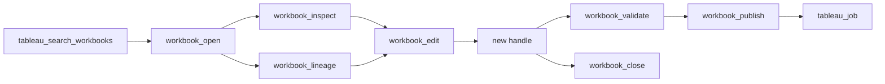

# MCP server

`tabkit-mcp` exposes TabKit as nine MCP tools over stdio or Streamable HTTP.

## Transport

| Mode | Endpoint | Local paths | Authentication |
| --- | --- | --- | --- |
| stdio | process stdin/stdout | enabled | process boundary |
| HTTP | `/mcp` | disabled unless `--allow-local-paths` | optional bearer token |

HTTP example:

```bash
TABKIT_MCP_TOKEN="<token>" tabkit-mcp --transport http --bind 127.0.0.1:8000
```

A non-loopback HTTP listener without `TABKIT_MCP_TOKEN` fails unless
`--allow-unauthenticated-http` is set. With that flag, TabKit performs no HTTP authentication;
deployment network controls must restrict access.

## Tool lifecycle



| Tool | Contract |
| --- | --- |
| `tableau_search_workbooks` | exact-name search, then bounded case-insensitive substring fallback |
| `workbook_open` | download by Tableau LUID or open an enabled local TWB/TWBX path |
| `workbook_inspect` | bounded semantic-object inspection; no raw XML |
| `workbook_lineage` | bounded upstream/downstream trace from one resolved object |
| `workbook_edit` | apply typed edit batch; returns a new immutable candidate handle |
| `workbook_validate` | call Tableau REST `validateWorkbook` |
| `workbook_publish` | publish one handle to a Tableau project |
| `tableau_job` | read Tableau background-job state |
| `workbook_close` | release handle and owned temporary file when no in-flight reference remains |

## Handles

A handle represents one immutable package/workbook/lineage snapshot.

| Property | Behavior |
| --- | --- |
| live-handle limit | 64 |
| edit | source handle unchanged; new candidate handle returned |
| downloaded files | owned by TabKit temporary workspace |
| edited candidates | owned by TabKit temporary workspace |
| user local files | never deleted by handle cleanup |
| close during in-flight operation | file remains until final `Arc<Session>` reference drops |

`workbook_open` returns the handle, workbook summary, and lineage-gap count. Server-downloaded opens
also return download bytes, SHA-256, format, and Tableau workbook LUID.

## Inspect

Supported `kind` values:

`datasource` · `connection` · `relation` · `field` · `calculation` · `parameter` · `worksheet` · `dashboard`

Lookup behavior:

1. exact case-insensitive name/caption match;
2. substring fallback only when no exact match exists;
3. result reports `count`, `total`, and `truncated`.

MCP limit: 1..500 objects; default 100.

## Lineage trace

| Argument | Contract |
| --- | --- |
| `query` | object name/caption |
| `kind` | optional disambiguation |
| `direction` | `upstream` or `downstream`; default downstream |
| `limit` | 1..1000 nodes; default 200 |

The starting query must resolve to exactly one lineage node. The tool rejects zero or multiple matches
as invalid parameters.

Lineage model: [Architecture](ARCHITECTURE.md#lineage).

## Tableau configuration

Server-backed tools require:

```text
TABLEAU_SERVER=https://tableau.example.com
TABLEAU_SITE=site-content-url
TABLEAU_PAT_NAME=pat-name
TABLEAU_PAT_SECRET=pat-secret
```

Tableau sign-in is lazy: starting `tabkit-mcp` validates static configuration but does not authenticate
until the first Tableau-backed tool call.

REST behavior: [Tableau REST](TABLEAU_REST.md).

## Error mapping

| TabKit condition | MCP category |
| --- | --- |
| unknown handle | resource not found |
| invalid/unsupported caller input | invalid params |
| configuration, runtime state, Tableau transport/upstream failure | internal error |

Every mapped tool error preserves `data.tabkit_code`. Full code contract:
[Errors](ERRORS.md).
