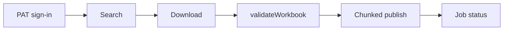
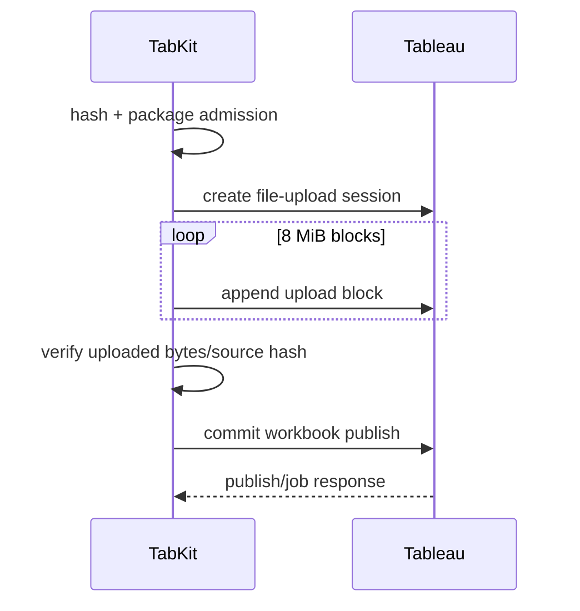

# Tableau REST

TabKit's server boundary is pinned to Tableau REST **3.29** for the Tableau **2026.2.4** target.

## Connection contract

| Property | Behavior |
| --- | --- |
| server URL | HTTPS only |
| REST version | exactly 3.29 |
| authentication | Personal Access Token |
| PAT secret | read from named environment variable |
| redirects | disabled |
| connect timeout | 15 s |
| request timeout | configurable; CLI/MCP default 120 s |
| Tableau session | bound to the signed-in site |

The PAT secret is not stored in `Config` and is not included in TabKit error text.

## Operations



| Operation | REST behavior |
| --- | --- |
| workbook search | exact name first; bounded substring fallback |
| download | streamed, bounded, SHA-256 hashed, then package-admitted |
| validation | submits TWB XML to `validateWorkbook` |
| publish | upload session + 8 MiB blocks + commit |
| job | reads Tableau background job by LUID |
| sign-out | invalidates Tableau session token |

## Search

`search_workbooks(query, limit)`:

- `limit`: 1..100;
- exact Tableau name filter first;
- when exact search is empty, case-insensitive substring search scans at most ten 1,000-item pages;
- the fallback therefore does not claim exhaustive search beyond 10,000 returned workbook records.

Returned metadata includes workbook/project IDs and names plus available `contentUrl`, `updatedAt`,
and `hasExtracts` fields.

## Download

Downloads are streamed under the package file-size bound and hashed while writing.

`download_workbook_auto` detects the returned payload:

| Prefix | Format |
| --- | --- |
| ZIP local-file header | TWBX |
| other non-empty payload | TWB |

Before the path is returned, the file passes the same [package admission](WORKBOOK.md#admission-limits)
as a local workbook.

MCP `workbook_open(workbook_id=...)` stores the downloaded file in TabKit's private workspace.

## Validation

`validate_workbook` opens the package, extracts the TWB, and posts that XML to Tableau
`validateWorkbook`.

| Tableau result | TabKit result |
| --- | --- |
| success | `valid: true` |
| HTTP 422 | `valid: false` with Tableau response body |
| auth/transport/server rejection | TabKit error |

For TWBX input, packaged resources are **not** submitted to `validateWorkbook`. Package/resource
acceptance is exercised by publish.

## Publish

Publish starts from an admitted stable package snapshot.



The source is hashed before upload and checked again after the upload stream. Concurrent modification
fails with `STALE_BASE` before commit.

`overwrite=false` is the default. Publish does not wait for background-job completion; use
`tableau_job` / `Rest::job` with the returned job LUID.

## Error surface

Structured Tableau rejections preserve, when available:

```text
HTTP status
Tableau error.code
summary
detail
```

Responses with an unexpected shape fail as `REST_SHAPE` rather than being partially guessed.

Error code mapping: [Errors](ERRORS.md).
