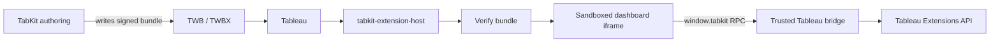
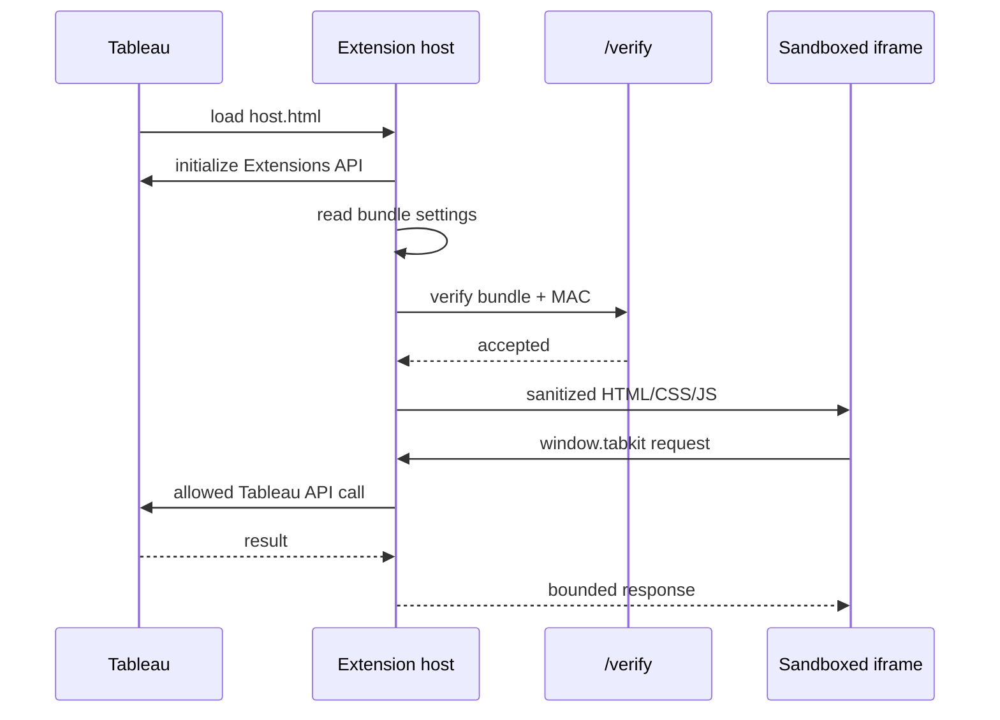

# Web dashboards

A web dashboard is a fixed-size Tableau dashboard containing one full-canvas TabKit Dashboard Extension.
The dashboard UI is supplied as HTML/CSS/JavaScript and stored inside the workbook.

## Contract

| Item | Behavior |
| --- | --- |
| Authoring operation | `create_web_dashboard` |
| Presentation | one full-canvas Dashboard Extension |
| UI source | HTML + CSS + JavaScript stored in the workbook |
| Tableau access | `window.tabkit` bridge only |
| Production host | one stable HTTPS `host.html` URL |
| Production integrity | HMAC-SHA256 signed bundle |
| Tableau permission | Full Data Access |
| Runtime | `tabkit-extension-host` |



The host is generic. Dashboard-specific HTML/CSS/JavaScript stays in the workbook, so one host can serve many workbooks.

## Create a dashboard

```json
{
  "op": "create_web_dashboard",
  "name": "Executive Overview",
  "width": 1440,
  "height": 900,
  "extension_url": "https://bi.example.com/tabkit/host.html",
  "html": "<main id=\"app\"></main>",
  "css": "#app { display: grid; }",
  "javascript": "const sources = await tabkit.listDataSources();"
}
```

| Field | Requirement |
| --- | --- |
| `name` | new dashboard name |
| `width`, `height` | positive fixed pixel dimensions |
| `extension_url` | HTTPS for remote hosts; localhost HTTP allowed for development |
| `html` | body content |
| `css` | optional inline CSS |
| `javascript` | optional JavaScript executed inside the sandbox |

All web dashboards created in one edit batch must use the same `extension_url`.

TabKit writes:

- the Tableau Dashboard Extension object;
- the referenced-extension manifest;
- `tabkit.bundle_b64` containing `runtime_version`, HTML, CSS, and JavaScript;
- `tabkit.bundle_mac` containing the bundle signature.

Production does **not** require installing the checked-in `.trex` file.

## Runtime

On dashboard open:



The iframe does not receive `tableau.extensions` and cannot make network requests directly
(`connect-src 'none'`). Tableau interaction is restricted to the bridge below.

## Bridge API

| Method | Result / effect |
| --- | --- |
| `listDataSources()` | dashboard data sources |
| `listLogicalTables(datasource)` | logical tables for one data source |
| `getLogicalTableData(datasource, table, maxRows?)` | underlying logical-table rows |
| `listWorksheets()` | dashboard worksheets |
| `getSummaryData(worksheet, maxRows?)` | worksheet summary data |
| `applyFilter(worksheet, field, values)` | apply categorical filter values |
| `clearFilter(worksheet, field)` | clear one worksheet filter |
| `listParameters()` | workbook parameters |
| `setParameter(name, value)` | set one parameter value |
| `on(event, handler)` | subscribe to bridge events; returns unsubscribe function |

Events:

| Event | Payload |
| --- | --- |
| `filterChanged` | `{ worksheet, fieldName }` |
| `selectionChanged` | `{ worksheet }` |
| `summaryDataChanged` | `{ worksheet }` when supported by the Tableau runtime |

## Security boundary

| Control | Enforcement |
| --- | --- |
| Remote host transport | HTTPS only |
| Bundle authenticity | HMAC-SHA256 with `TABKIT_EXTENSION_SIGNING_KEY` |
| Unsigned bundles | localhost development only |
| Tableau access | allowlisted bridge methods; no raw Extensions API in generated code |
| Browser isolation | sandboxed iframe + CSP |
| External network from generated UI | blocked by CSP |
| Tableau permissions | workbook/data-source/user permissions remain enforced |
| Underlying data access | requires Tableau Full Data Access |

The authoring process and `tabkit-extension-host` must use the same base64-encoded 32-byte
`TABKIT_EXTENSION_SIGNING_KEY`. The official Tableau MCP server does not use this key.

## Runtime limits

| Limit | Value |
| --- | ---: |
| rows per data request | 100,000 |
| returned row-data budget | ~8 MiB |
| bridge request serialization | 64 KiB |
| bridge response serialization | 16 MiB |
| concurrent bridge requests | 4 |
| host-side request timeout | 30 s |
| iframe-side request timeout | 35 s |
| HTML + CSS + JavaScript | 1 MiB |
| serialized bundle | 2 MiB |

Summary and logical-table data are read page-by-page; row and byte limits are applied while reading.

## Production requirements

A production dashboard needs all five:

1. `tabkit-extension-host` running;
2. public HTTPS route to `/tabkit/host.html`;
3. the host URL allowed in Tableau Server **Settings -> Extensions**;
4. **Full Data Access = Allow**;
5. the same signing key on authoring and host processes.

Deployment procedure: [Extension host deployment](EXTENSION_DEPLOYMENT.md).
