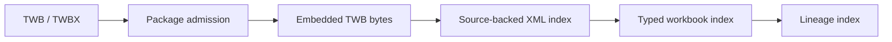
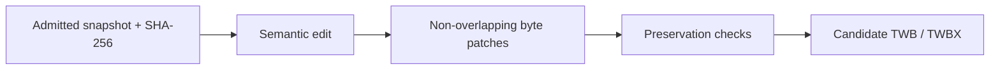

# Workbook and package model

TabKit operates on TWB/TWBX snapshots. Package admission happens before semantic indexing.

## Open path



| Layer | Owns |
| --- | --- |
| package | file type, size limits, TWBX ZIP safety, source hash |
| XML | source spans, attributes, parent/child links, subtree ranges |
| workbook | supported Tableau 26.2 semantic objects |
| lineage | dependency edges and coverage gaps |

The original TWB source remains authoritative. TabKit does not deserialize the entire workbook into a
second object model.

## Admission limits

Default limits:

| Limit | Value |
| --- | ---: |
| embedded TWB XML | 256 MiB |
| package file | 4 GiB |
| TWBX entries | 8,192 |
| TWBX expanded bytes | 16 GiB |
| per-entry compression ratio guard | 5000x + 1 MiB allowance |

TWBX admission rejects:

- absolute/traversal/invalid entry paths;
- duplicate or case-colliding names;
- symlink entries;
- expanded-size overflow;
- suspicious compression ratio;
- zero or multiple embedded TWB files.

## Version gate

The semantic index admits only:

```text
workbook/@version = 26.2
Tableau target     = 2026.2.4
XSD contract       = 2026.2.0
```

A different workbook version fails with `VERSION` before semantic operations run.

## Indexed objects

`Workbook::summary()` and MCP inspection cover:

| Object | Indexed data |
| --- | --- |
| datasource | name/caption and datasource identity |
| connection | connection identity and supported connection metadata |
| relation | physical/custom SQL/relationship subset used by lineage |
| field | datasource, name/caption, datatype, role/type, calculation link |
| calculation | output field + formula |
| parameter | name/caption, datatype, domain, current value |
| worksheet | name and XML node identity |
| dashboard | name and XML node identity |

Counts describe TabKit's semantic projection, not every element allowed by Tableau's XSD.

## Source-preserving edits



Patch admission requires:

- valid UTF-8 byte boundaries;
- non-overlapping ranges;
- exact expected source bytes;
- bounded candidate size.

Unchanged XML regions are compared byte-for-byte after patching.

For TWBX candidates, only the embedded TWB is replaced. Unrelated entries must preserve:

- entry count/order/name;
- uncompressed and compressed sizes;
- compression method;
- compressed bytes.

The source package hash is checked before and after candidate repack. A concurrent source change
fails with `STALE_BASE`.

## Candidate rule

A candidate keeps the source package type:

```text
.twb  -> .twb
.twbx -> .twbx
```

Existing output paths are never overwritten.

Tableau remains responsible for XSD and Tableau semantic validation:
[Tableau REST](TABLEAU_REST.md#validation).
